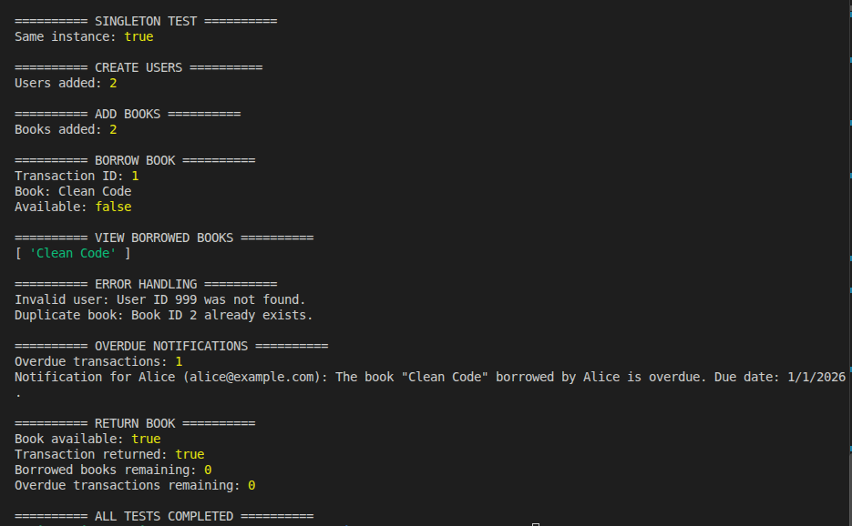

# Library Management System

A simple Library Management System built with JavaScript and Object-Oriented Design (OOD) principles.

## Users

The system supports two types of users:

- **Student:** Identified by a student ID.
- **Teacher:** Identified by an employee ID.

Both inherit from the abstract `User` class, which defines their shared properties and methods. The `UserFactory` creates the appropriate user based on their type.

## Features

- Add and manage users and books.
- Borrow and return books.
- View books borrowed by a user.
- Track borrowing transactions and overdue books.
- Simulate overdue notifications.
- Prevent duplicate user and book IDs.
- Handle invalid operations with error messages.

## Design Patterns

- **Factory:** Creates students and teachers through `UserFactory`.
- **Singleton:** Ensures a single `LibrarySystem` instance.
- **Observer:** Simulates notifications for overdue books.

## Tests

